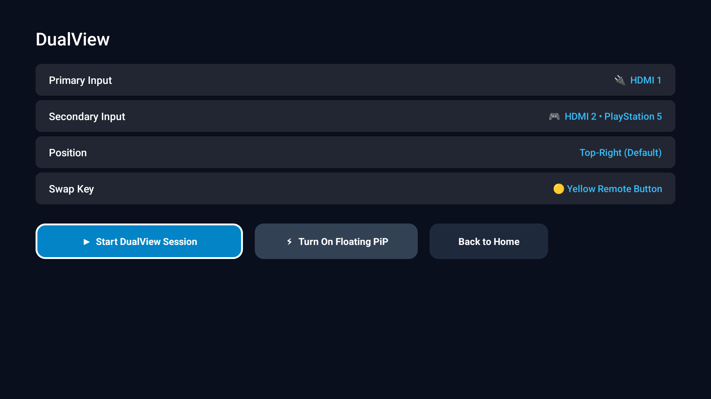
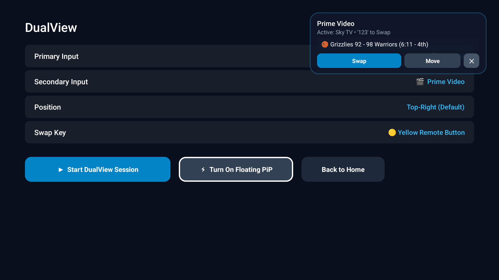

# Google TV Launcher

A minimal, ad-free launcher for Google TV and Android TV. Includes HDMI DualView Picture-in-Picture, a standalone Settings app, live sports scores, Trakt sync, and hardware remote button remapping.

Written in native Java with zero bloat and a sub-80 MB memory footprint.

---

## Interface

| Home | Settings |
| :---: | :---: |
|  |  |

| DualView Setup | Floating Overlay Over App |
| :---: | :---: |
|  |  |

| Inputs |
| :---: |
|  |

---

## Features

### DualView (Picture-in-Picture)
* **1 Google TV App + 1 HDMI Input**: Watch Stremio, Sky TV, or YouTube with a live floating preview and instant swap to PlayStation 5 or console.
* **2 Google TV Apps**: Multitask between two streaming apps (e.g. Prime Video + Stremio / Sky TV).
* **2 HDMI Inputs**: Pair two physical HDMI inputs (e.g. PlayStation 5 + Fire TV Stick).
* **Instant 1-Click Swap**: Toggle between sources with the physical "123" remote button or the floating overlay `Swap` trigger.
* **Native Source Picker**: Auto-detects all installed Leanback apps and hardware HDMI ports.
* **Floating Overlay**: Live sports scores ticker, draggable/cycleable corners (`Move`), and clean minimal typography.

### Settings App
* Standalone Leanback TV app with two-pane navigation.
* Configure HDMI pairings, remote keys, and home layout.
* Live Remote Key Tester showing hardware keycodes in real time.
* Toggle sports feeds (NBA, NFL, Premier League, Champions League, MLB, NHL).
* RAM monitor and one-click memory cache trimmer.

### Remote Key Remapping
* System-wide hardware remote button handling via Android Accessibility.
* Intercepts and restores the physical Inputs button across all screens.
* Maps the "123" virtual remote key (`KEYCODE_WINDOW` 171) to trigger HDMI swap.

### Integrations
* Real-time scoreboards via ESPN APIs with priority team pins.
* Trakt cloud watchlist and Next Up episode tracking with Stremio integration.

---

## Project Structure

```
googletv-launcher/
├── launcher/
│   ├── app/src/main/
│   │   ├── java/com/gathin/tvhome/
│   │   │   ├── MainActivity.java              # Home screen
│   │   │   ├── HubDataFetcher.java            # ESPN and Trakt data client
│   │   │   ├── RemoteKeyMapperService.java    # Accessibility key mapper
│   │   │   ├── pip/
│   │   │   │   ├── PipOverlayService.java     # Floating PiP overlay
│   │   │   │   └── PipSettingsActivity.java   # DualView configuration app
│   │   │   └── settings/
│   │   │       └── LauncherSettingsActivity.java # Settings app
│   │   └── AndroidManifest.xml
│   └── build-and-install.sh
└── tools/
    ├── web_remote.py                          # Browser remote & control center
    ├── tv.py                                  # ADB wrapper
    ├── b64push.py                             # Fast APK push
    └── restore.sh                             # Stock restore script
```

---

## Installation

### Prerequisites
* Google TV or Android TV with USB / Network debugging enabled
* Computer on the same local network
* Java 17+ and Android SDK platform 34

### Build and Install
```bash
TV_HOST=192.168.0.87 launcher/build-and-install.sh
```

### Factory Restore
```bash
TV_HOST=192.168.0.87 tools/restore.sh
```

---

## License

MIT License &copy; 2026 Dhruv Gandhi.
The Outfit typeface is licensed under the SIL Open Font License.
